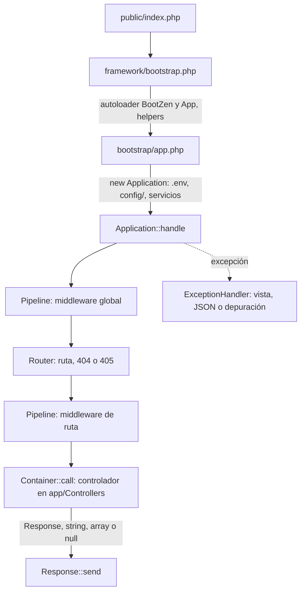

# Arquitectura BootZen

## Visión general

BootZen es un boilerplate para aplicaciones PHP monolíticas. Cada proyecto
contiene el código del framework en `framework/` (namespace `BootZen\`) y su
propio código en `app/` (namespace `App\`). No hay `.phar` ni dependencias de
Composer en producción: el proyecto funciona subiendo los archivos a cualquier
servidor con PHP 8.2 o superior.

La hoja de ruta completa está en
[plan/04_PLAN-MVP-MONOLITO.md](../plan/04_PLAN-MVP-MONOLITO.md).

---

## Diagrama de arranque



1. `public/index.php` carga `framework/bootstrap.php`.
2. `bootstrap.php` define `BOOTZEN_BASE_PATH`, registra el autoloader PSR-4
   para `BootZen\` y `App\`, carga `vendor/autoload.php` si existe (solo en
   desarrollo) y los helpers globales.
3. `bootstrap/app.php` crea la `Application` con la raíz del proyecto. Al
   construirse carga `.env` (sin pisar variables reales del entorno), la
   configuración de `config/` (o su caché en `storage/cache/config.php`),
   fija la zona horaria y registra los servicios. Después se registran los
   alias, grupos y middleware global, y las rutas de `routes/web.php`. Los
   tests usan el mismo archivo.
4. `Application::handle()` registra los manejadores globales de errores,
   construye el `Request`, ejecuta el middleware global y el router, y envía
   la respuesta. `run()` hace lo mismo sin tocar el estado global de PHP (lo
   usan los tests).
5. Toda excepción pasa por el `ExceptionHandler`: `HttpException` (de
   `abort()` o del router) conserva su código; cualquier otra es un 500 que se
   registra en `storage/logs`. La respuesta es JSON si el cliente lo pide, la
   vista `errors/{codigo}.php` (o `errors/default.php`) en otro caso, y una
   página de depuración en errores 500 con `APP_DEBUG=true`.

---

## Estructura del repositorio

```
bootzen/
├── framework/        # Código del framework, se copia tal cual a cada proyecto
│   ├── bootstrap.php
│   └── src/          # Core, Components, Middleware, Helpers
├── skeleton/         # Boilerplate de un proyecto nuevo
├── bin/bootzen-new   # Instalador de proyectos (PHP)
├── tests/            # Tests del framework y del instalador (Pest)
├── docs/             # Documentación
└── plan/             # Hoja de ruta y seguimiento
```

## Estructura de un proyecto generado

```
mi-app/
├── app/Controllers/   # Código de la aplicación (App\)
├── bootstrap/app.php  # Construcción de la aplicación
├── routes/web.php     # Rutas
├── resources/views/   # Vistas
├── public/            # Document root
├── storage/           # Logs y cachés
├── database/          # SQLite local
├── tests/             # Pest
├── framework/         # BootZen
└── AGENTS.md          # Guía para agentes de IA
```

---

## Componentes del framework

- **Application**: orquesta el ciclo de vida, carga entorno y configuración,
  registra servicios y delega errores al `ExceptionHandler`.
- **Container**: inyección de dependencias con autowiring; `call()` inyecta
  parámetros de ruta por nombre y dependencias por tipo.
- **Router / Route**: rutas con patrones compilados, restricciones, nombres,
  grupos (`prefix`, `as`, `middleware`), `resource()`, 404/405 y `OPTIONS`.
- **Pipeline**: un solo mecanismo de middleware (global y de ruta) con alias
  y grupos.
- **Request / Response**: abstracciones HTTP inmutables; `input()`, `only()`,
  `param()`, `_method`, `wantsJson()`.
- **Env / Config**: `.env` sin dependencias y configuración por archivos con
  caché.
- **Logger / Cache**: log diario PSR-3 y caché de archivos.
- **ExceptionHandler / HttpException**: errores HTTP con vistas, JSON o
  página de depuración.
- **MiddlewareInterface**: contrato `process(Request, callable $next)`.
- **Helpers**: funciones globales (`env`, `base_path`, `e`, `redirect`,
  `abort`, `logger`, etc.). Ninguna termina la ejecución con `exit`.
- **View / ViewCompiler**: vistas `.php` con una lista cerrada de directivas
  y componentes `<x-*>` (slots, `@props`, `$attributes`), compiladas a
  `storage/cache/views` con la misma numeración de líneas que el original.
- **View\Component**: base opcional para componentes con lógica
  (`app/View/Components`).
- **Frontend\Tailwind**: descarga verificada (SHA-256) del CLI standalone de
  Tailwind v4 y comandos de compilación.
- **Database**: `Connection` (PDO; SQLite con WAL por defecto, MySQL
  opcional), `QueryBuilder` con parámetros enlazados e identificadores
  validados, `Paginator`, `Model` (Active Record ligero con casts, timestamps,
  `hasMany` y `belongsTo`), migraciones con SQL directo (`Migrator`) y seeders.
  La conexión se abre solo cuando se usa.
- **Session**: sesión propia guardada en `storage/sessions` (no usa
  `session_start()`), con flash, `old()`, errores de validación y token CSRF.
  La abre el middleware `StartSession` y escribe la cookie en el `Response`;
  si la petición no la usa, no crea archivo ni cookie.
- **Validation**: `Validator` con una lista cerrada de reglas y mensajes en
  español; `Request::validate()` y `ValidationException` (redirección con
  errores en formularios, 422 en JSON).
- **Auth**: guard de sesión (`auth()`), `Hash` (Argon2id o bcrypt) y
  `PasswordReset` (tokens guardados como hash). Scaffold opcional con
  `bootzen-new --auth` desde `stubs/auth`.
- **Security / Mail**: `RateLimiter` sobre la caché y `Mailer` con drivers
  `log` y `array`.
- **Middleware**: `StartSession` y `VerifyCsrfToken` (grupo `web`),
  `SecurityHeaders` (global), `RateLimit` (`throttle:max,minutos`),
  `Authenticate` (`auth`), `RedirectIfAuthenticated` (`guest`) y CORS.
- **Console**: `bin/bootzen` (serve, css:*, view:*, migrate, migrate:rollback,
  migrate:status, db:seed, db:fresh, db:backup, make:*, route:list,
  config:cache, config:clear, key:generate, doctor y check). `Generator` crea
  archivos desde las plantillas de `framework/stubs` (nunca sobrescribe) y
  `make:resource` arma la rebanada completa con tests; `Doctor` revisa el
  entorno antes de desplegar.
- **Testing**: `TestClient` y `TestResponse` para tests de feature en los
  proyectos (`client()->get('/')->assertOk()`), con cookies de sesión,
  `actingAs()` y aserciones de base de datos.
- **Support\Str**: conversión de nombres y plurales en inglés para los
  generadores.
- **UploadedFile**: `$request->file('campo')` con `store()` (privado, en
  `storage/app`) y `storePublic()` (en `public/uploads`), nombre aleatorio y
  extensión tomada del tipo detectado.
- **Capa para IA** (en cada proyecto): `AGENTS.md`, `docs/ai/recipes`,
  `docs/ai/reference.md` (generada con `bin/bootzen-reference`), `llms.txt` y
  skills en `.claude/skills` y `.agents/skills`.
- **bootzen.js** (en el skeleton, `public/assets/js`): runtime de JS nativo
  con componentes `data-component`, `request()`, `toast()` y atributos
  declarativos.

---

## Distribución y actualización

- `bin/bootzen-new` copia `skeleton/` y `framework/` a un directorio nuevo y
  reemplaza los marcadores `__APP_NAME__` y `__APP_SLUG__`.
- `install.sh` clona el repo en `~/.bootzen` y agrega `~/.bootzen/bin` al
  `PATH`. `updater.sh` lo mueve al último release, tag o `main`.
- Cada release publica `bootzen-<tag>.tar.gz` con framework, skeleton e
  instalador, después de pasar `composer check`.
