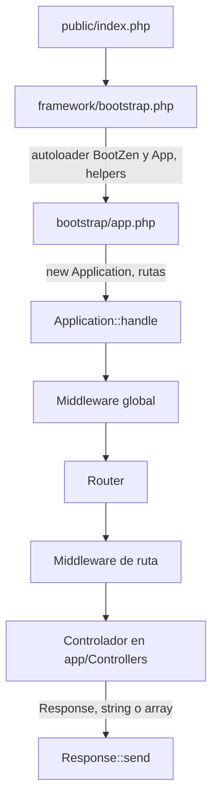

# Arquitectura BootZen

## Visión general

BootZen es un boilerplate para aplicaciones PHP monolíticas. Cada proyecto
contiene el código del framework en `framework/` (namespace `BootZen\`) y su
propio código en `app/` (namespace `App\`). No hay `.phar` ni dependencias de
Composer en producción: el proyecto funciona subiendo los archivos a cualquier
servidor con PHP 8.2 o superior.

La hoja de ruta completa está en
[plan/04_PLAN-MVP-MONOLITO.md](../plan/04_PLAN-MVP-MONOLITO.md).

---

## Diagrama de arranque



1. `public/index.php` carga `framework/bootstrap.php`.
2. `bootstrap.php` define `BOOTZEN_BASE_PATH`, registra el autoloader PSR-4
   para `BootZen\` y `App\`, carga `vendor/autoload.php` si existe (solo en
   desarrollo) y los helpers globales.
3. `bootstrap/app.php` crea la `Application`, registra middleware global y
   las rutas de `routes/web.php`, y retorna la instancia. Los tests la usan
   igual.
4. `Application::handle()` construye el `Request`, ejecuta el pipeline y envía
   la respuesta. Las excepciones se convierten en respuestas: `HttpException`
   (lanzada por `abort()`) conserva su código; cualquier otra es un 500 sin
   detalles salvo con `APP_DEBUG`.

---

## Estructura del repositorio

```
bootzen/
├── framework/        # Código del framework, se copia tal cual a cada proyecto
│   ├── bootstrap.php
│   └── src/          # Core, Components, Middleware, Helpers
├── skeleton/         # Boilerplate de un proyecto nuevo
├── bin/bootzen-new   # Instalador de proyectos (PHP)
├── tests/            # Tests del framework y del instalador (Pest)
├── docs/             # Documentación
└── plan/             # Hoja de ruta y seguimiento
```

## Estructura de un proyecto generado

```
mi-app/
├── app/Controllers/   # Código de la aplicación (App\)
├── bootstrap/app.php  # Construcción de la aplicación
├── routes/web.php     # Rutas
├── resources/views/   # Vistas
├── public/            # Document root
├── storage/           # Logs y cachés
├── database/          # SQLite local
├── tests/             # Pest
├── framework/         # BootZen
└── AGENTS.md          # Guía para agentes de IA
```

---

## Componentes del framework

- **Application**: orquesta el ciclo de vida, el contenedor, el middleware
  global y el manejo de errores.
- **Container**: inyección de dependencias con autowiring por reflexión.
- **Router / Route**: rutas por método, parámetros `{id}`, grupos con prefijo
  y middleware.
- **Request / Response**: abstracciones HTTP inmutables.
- **HttpException**: error HTTP con código y cabeceras; lo lanza `abort()`.
- **MiddlewareInterface**: contrato `process(Request, callable $next)`.
- **Helpers**: funciones globales (`env`, `base_path`, `e`, `redirect`,
  `abort`, `logger`, etc.). Ninguna termina la ejecución con `exit`.
- **Component** y `Components/`: componentes como clases PHP. Se reemplazan
  por componentes de vista `<x-*>` en la fase 2.

---

## Distribución y actualización

- `bin/bootzen-new` copia `skeleton/` y `framework/` a un directorio nuevo y
  reemplaza los marcadores `__APP_NAME__` y `__APP_SLUG__`.
- `install.sh` clona el repo en `~/.bootzen` y agrega `~/.bootzen/bin` al
  `PATH`. `updater.sh` lo mueve al último release, tag o `main`.
- Cada release publica `bootzen-<tag>.tar.gz` con framework, skeleton e
  instalador, después de pasar `composer check`.
